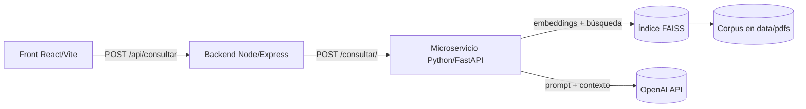

# Asistente IA — Chatbot sobre Corpus Documental

Chatbot de propósito general basado en **RAG (Retrieval-Augmented Generation)**: responde preguntas en lenguaje natural apoyándose únicamente en un corpus de documentos que tú le entregues (PDFs, manuales, normativas, FAQs, etc.). No está atado a un dominio concreto — el rol del asistente y el corpus son configurables, por lo que el mismo esqueleto sirve para entrenar y servir distintos chatbots.

> El repositorio incluye, como corpus de ejemplo, un conjunto de normas contables (NIIF, NIA, NICSP) en `asistente-ia-python/data/pdfs/`. Es solo un caso de prueba: puedes reemplazarlo por cualquier otro corpus lingüístico siguiendo los pasos de la sección [Cargar tu propio corpus](#cargar-tu-propio-corpus).

## Arquitectura



| Capa | Carpeta | Responsabilidad |
|---|---|---|
| **Front** | [`Asistente-Front/chatbot-ia`](Asistente-Front/chatbot-ia) | Interfaz de chat en React + Vite. |
| **Backend** | [`asistente-ia-node`](asistente-ia-node) | API en Express; recibe la pregunta del front, le añade el prompt del sistema y la reenvía al microservicio de IA. |
| **Microservicio IA** | [`asistente-ia-python`](asistente-ia-python) | FastAPI + FAISS + OpenAI. Extrae texto de los PDFs, genera embeddings, indexa el corpus y responde preguntas usando el contexto recuperado. |

## Estructura del repositorio

```
.
├── Asistente-Front/chatbot-ia/      # Front (React + Vite)
├── asistente-ia-node/               # Backend (Node + Express)
│   └── src/
│       ├── server.js                # Endpoints y arranque del servidor
│       ├── prompts.js               # Prompt de sistema (configurable)
│       └── services/iaService.js    # Cliente HTTP hacia el microservicio Python
└── asistente-ia-python/             # Microservicio IA (FastAPI)
    ├── app/
    │   ├── main.py                  # Endpoints FastAPI
    │   ├── extractor.py             # PDF -> texto fragmentado (.jsonl)
    │   ├── embedder.py               # .jsonl -> embeddings -> índice FAISS
    │   ├── create_index.py          # Atajo: PDFs -> índice FAISS en un solo paso
    │   ├── retriever.py              # Búsqueda semántica sobre el índice
    │   └── prompts.py                # Prompt de sistema + llamada a OpenAI
    └── data/
        ├── pdfs/                    # Documentos fuente del corpus
        ├── corpus_jsonl/             # Texto fragmentado (generado)
        └── faiss_index/              # Índice vectorial (generado)
```

## Requisitos previos

- Node.js 18+
- Python 3.10+
- Una clave de API de OpenAI (embeddings + modelo de chat)

## Variables de entorno

Cada servicio usa su propio `.env` (ignorado por git).

**`asistente-ia-python/.env`**

| Variable | Descripción | Valor por defecto |
|---|---|---|
| `OPENAI_API_KEY` | Clave de OpenAI para embeddings y generación de respuesta. | — (requerida) |
| `SYSTEM_PROMPT` | Rol/instrucciones del asistente. | Asistente genérico basado en contexto |

**`asistente-ia-node/.env`**

| Variable | Descripción | Valor por defecto |
|---|---|---|
| `PORT` | Puerto del backend Node. | `4000` |
| `PYTHON_URL` | URL del microservicio Python. | `http://127.0.0.1:8001` |
| `SYSTEM_PROMPT` | Rol/instrucciones del asistente (se añade al contexto antes de reenviarlo). | Asistente genérico basado en contexto |

## Instalación y ejecución

### 1. Microservicio Python (IA + búsqueda semántica)

```bash
cd asistente-ia-python
python3 -m venv venv && source venv/bin/activate
pip install -r app/requirements.txt
echo "OPENAI_API_KEY=tu-api-key" > .env

uvicorn app.main:app --reload --port 8001
```

### 2. Backend Node

```bash
cd asistente-ia-node
npm install
echo "PORT=4000\nPYTHON_URL=http://127.0.0.1:8001" > .env

npm run dev
```

### 3. Front (React + Vite)

```bash
cd Asistente-Front/chatbot-ia
npm install
npm run dev
```

Abre `http://localhost:5173` — el chat quedará conectado al backend (`http://localhost:4000`) y este al microservicio IA (`http://127.0.0.1:8001`).

## Cargar tu propio corpus

1. Coloca tus documentos (`.pdf`) en `asistente-ia-python/data/pdfs/`.
2. Genera el índice vectorial con **una** de estas dos opciones:
   - Todo en un paso: `python app/create_index.py`
   - Por etapas (útil si quieres inspeccionar el texto fragmentado): `python app/extractor.py` y luego `python app/embedder.py`
3. Ajusta `SYSTEM_PROMPT` en el `.env` correspondiente para darle al bot el rol adecuado a tu corpus (por ejemplo: *"Eres un asistente experto en soporte técnico de producto X, responde solo con base en el manual proporcionado"*).
4. Reinicia el microservicio Python para que cargue el nuevo índice.

## Estado del proyecto

Base funcional (front + backend + microservicio RAG) lista para adaptarse a un nuevo corpus y caso de uso. Pendiente de definir licencia.
